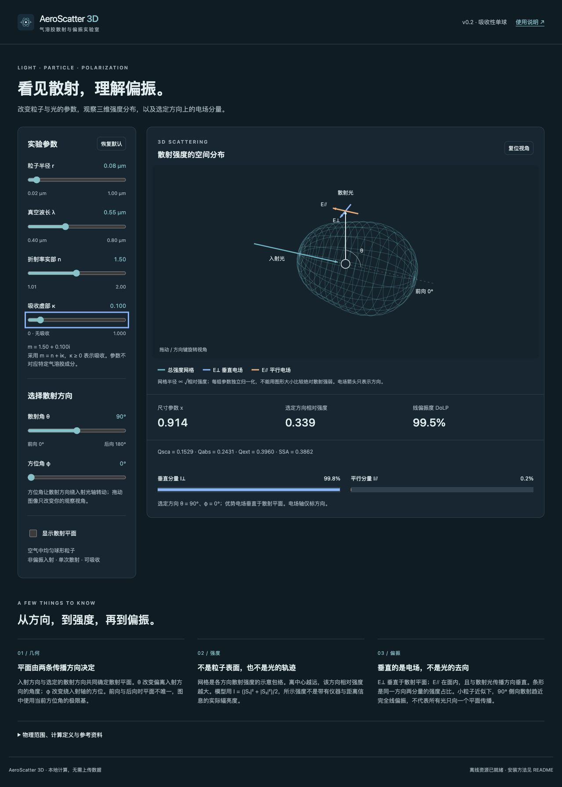

# AeroScatter 3D · v0.3

## v0.3：长短轴调节

轴比 c/a 可调 0.25–4：1 为球体，>1 为长椭球，<1 为扁椭球；r 为等体积半径，r³=a²c。点击“椭球示例”可直接进入可计算参数。

球体仍使用完整 Mie 级数。非球形使用带辐射反作用修正的准静态电偶极近似，对称轴固定 Z、入射沿 X；要求 |m|·2π·max(a,c)/λ≤0.3，超限停止绘图。该阈值不是精度保证，尚无有限尺寸椭球独立数值基准，不可替代 T-matrix/DDA。轴比切换跨越模型，不能把两种模型差异全部解释为形状效应。

椭球总强度可依赖 φ，DoLP 包含相干矩阵非对角项，正前向也可能偏振。效率以等体积球截面 πr² 归一化。界面半径范围扩为 0.004–1 μm，但必须同时满足各模型尺寸限制。

当前 80 项测试通过，包含去极化因子积分参照、球形瑞利极限、角积分、能量闭合、方位角响应与界面超限清空。下面的 v0.2 球体定义及 74 项验证记录为历史基线，仅适用于球体；“不包括非球形”现指不支持通用有限尺寸非球形解。

交互式气溶胶散射与偏振教学工具。Explore single-sphere Mie scattering and polarization in 3D.

纯 HTML / CSS / JavaScript；无前端依赖、无 CDN、无账号、无遥测。所有计算在浏览器本地完成。



继续开发先读 [PROJECT_STATE.md](PROJECT_STATE.md)；[技术细节](docs/TECHNICAL.md)；[整理日志](logs/2026-10-21-development.md)；[跨聊天交接](HANDOFF.md)。

## 快速使用

**只想看图：直接用浏览器打开项目根目录的 `AeroScatter.html`。** 这是自包含单文件，无需 Node.js，也不依赖旁边的脚本或样式文件；不支持安装 PWA。由 `npm run build` 生成，修改源码后请重新生成。

**需要安装 PWA 或开发：**需要 **Node.js 22 或更新版本**。不需要 `npm install`。

macOS：双击项目里的 **`启动 AeroScatter.command`**，会打开本地网页。使用期间保留终端窗口；按 Ctrl+C 停止服务。首次启动如果系统阻止执行，请在终端使用下列命令，不要关闭系统安全保护。

也可以在本目录运行：

```sh
npm start
```

打开终端打印的地址，默认 <http://127.0.0.1:4173/>。若端口被占用，用 `PORT=4174 npm start`。

也支持直接双击 `web/index.html` 查看三维图（使用已生成的普通脚本，无模块跨文件加载）。这种本地文件模式不提供 PWA 安装；安装 App 仍请使用启动入口。离线 App 与直接打开本地文件不是一回事。

页面使用的 `web/app.bundle.js` 由源码模块合并生成。修改源码后运行 `npm run build`，或重新运行 `npm start`；不要手改生成文件。

## 功能与操作

- 调节粒子半径、真空波长、复折射率实部 n 与吸收虚部 κ。
- 显示散射效率 Qsca、吸收效率 Qabs、消光效率 Qext 和单次散射反照率 SSA。
- 调节散射角 θ 与方位角 φ，观察选定传播方向与电场基。
- 拖动三维图（或聚焦图后按方向键）改变相机视角；这不会改变散射角或物理计算。
- 散射平面默认关闭，可以勾选显示；改变 φ 时平面绕入射光轴旋转。
- 显示选定方向相对强度、线偏振度、垂直 / 平行强度占比。
- 保存上次使用参数与视角（仅本机浏览器 localStorage）；恢复默认可重置。
- 自适应手机 / 桌面、明暗外观；支持 PWA 安装与首次完整加载后的离线访问。

### 安装为 App

先通过 **localhost 或 HTTPS** 打开网页并等待底部显示“离线资源已就绪”。

- Chrome / Edge：浏览器支持时点击网页的“安装 App”按钮，或使用地址栏 / 菜单中的安装入口。
- Safari（支持的 macOS 版本）：菜单“文件 → 添加到程序坞”。iPhone / iPad 可通过分享菜单“添加到主屏幕”。
- 安装入口取决于浏览器与系统。没有入口时仍可作为普通网页使用；不提供原生 `.app` / `.exe` 安装包。
- 离线缓存可能被浏览器清理；本地服务停止后，已缓存的页面通常仍可使用，但重新联网获取更新时需要服务或公开站点可访问。

实现依据：[MDN：Making PWAs installable](https://developer.mozilla.org/en-US/docs/Web/Progressive_web_apps/Guides/Making_PWAs_installable)。开发者更新 `web/` 内容时需要同时更改 `sw.js` 的缓存版本；旧页面全部关闭后新缓存才会接管。

## 物理定义和适用范围

这是**均匀、可吸收、球形单粒子，非偏振入射，单次散射**的演示，不是完整的大气辐射传输模型，不是气溶胶成分 / 来源反演工具。

| 参数 | v0.2 范围 |
| --- | --- |
| 半径 r | 0.02–1 μm |
| 真空波长 λ | 0.40–0.80 μm |
| 相对折射率 m | m = n + iκ，n = 1.01–2，κ = 0–1 |
| 环境折射率 | 固定为 1（空气近似） |
| 尺寸参数 x | x = 2πr/λ；计算模块支持 0.05–16 |
| 散射角 θ / 方位角 φ | 0–180° / 0–360° |

入射传播方向固定为 +X。散射方向为 `(cosθ, sinθ cosφ, sinθ sinφ)`。

- `I⊥ = |S₁|²`，`I∥ = |S₂|²`；二者是非偏振入射下分量强度的共同尺度量，实际非偏振分量各带相同的 1/2 因子，计算占比时抵消。
- `I = (|S₁|² + |S₂|²)/2`，振幅采用 Wiscombe 归一化；未引入入射辐照度、距离与探测器响应，不能当作实际辐亮度。
- `DoLP = |I⊥ − I∥|/(I⊥ + I∥)`；有符号比值 > 0 表示垂直电场占优，< 0 表示平行电场占优。这里不宣称通用 Stokes Q 的符号约定。
- 线框半径正比于 `sqrt(I/Imax)`，而不是 I；每组参数重新归一化。**图形大小不能比较不同粒子的绝对散射能力。** Imax 来自 721 个等 θ 样本的估计值。
- 两条电场箭头始终与散射光垂直，只表示偏振基方向，不按振幅缩放。即使某分量趋近 0，该方向轴也保留。
- 在 0° / 180°，散射平面不唯一，采用当前方位角的极限基；无净线偏振。
- 非偏振光照射球体时，总强度不依赖 φ；改变 φ 改变的是方向与基，而不是同一 θ 下的强度数值。

虚部约定：界面与 JS 内部使用 `m = n + iκ`、时间因子 `exp(−iωt)` 与向外传播的第一类球 Hankel 函数，κ ≥ 0 表示吸收。独立参考 miepython 使用 `n − iκ`；参考脚本显式转换，不把负值静默翻转。详见[符号说明](docs/TECHNICAL.md)。

`Qabs = Qext − Qsca`，`SSA = Qsca/Qext`；Q 是以几何截面积 πr² 归一化的无量纲效率，不是能量百分比。κ 增大不保证所有角度的强度或偏振度单调变化。

不包括：非球形、粒径分布、多次散射、偏振入射、光谱积分、实际观测反演。即使加入吸收，也不能将某组 n/κ 直接解释为黑碳或某种气溶胶的成分 / 来源。

## 测试与独立数值参照

```sh
npm test
npm run build
```

测试无需 Python 或网络：

- 固化 **miepython 2.5.5** 独立参考值，采用 `norm='wiscombe'`，15 组 `(m,x)`；每组 Qsca 和 7 个角度的两种强度，共 225 个参考量。
- 新增 45 组吸收性参考：n = 1.01/1.5/2，κ = 0.001/0.1/1，x = 0.05/0.2/2/8/16；每组 3 个效率与 14 个角度分量，共 765 个参考量。两份基准合计 990 个参考量。
- 当前 74 项测试，包括 144 组吸收参数组合的能量闭合、吸收非负、SSA 有界，以及虚部 UI 联动。测试数量不是参考数据数量。
- `m = 1.01, 1.5, 2`，`x = 0.05, 0.2, 2, 8, 16`，角度为 0/30/60/90/120/150/180°。
- 跨实现比较容差：`1e-5 × |参考值| + 1e-18`。这是测试阈值，不是全参数域误差保证；接近零的分量不应用相对误差单独判断。
- 瑞利极限、正前 / 后向偏振、角积分与 Qsca 一致性、几何正交性、36 组界面参数组合扫描、输入边界。
- PWA 清单、图标尺寸、离线资源完整性、Service Worker 缓存回退单元测试。

重新生成独立参考输出（可选，需 Python + numpy + miepython）：

```sh
python scripts/reference.py
python scripts/reference-absorbing.py
```

先人工核对，再更新 `tests/miepython-reference.json` 或 `tests/absorbing-reference.json`；不要为了测试通过自动覆盖基准。

计算参考：[miepython 文档](https://miepython.readthedocs.io/en/stable/)、[振幅及归一化](https://miepython.readthedocs.io/en/v2.5.5/03_angular_scattering.html)。本项目用 JS 独立实现标准球形 Mie 级数，未内嵌 miepython 运行库。

界面及数值核查不等于科研级全域验证。浏览器实际安装、跨系统离线行为仍需要发布前的设备测试。

本地检查记录见 [VALIDATION.md](VALIDATION.md)。

## 项目结构

```text
web/                     静态网页与离线资源
  mie.js                 Mie 数值核心
  geometry.js            三维传播方向与偏振基
  app.js                 界面、三维投影与交互
  sw.js                  离线缓存
scripts/                 本地服务、打包、图标与独立参照脚本
tests/                   Node 测试与固定参考值
.github/workflows/       测试与 GitHub Pages 发布流程
启动 AeroScatter.command macOS 启动入口
```

零运行依赖，不要求 WebGL；三维模型使用 Canvas 2D 正交投影绘制。无需为了这个体量引入框架或桌面运行时。

## 之后发布到 GitHub

此版本只在本地创建，**没有自动创建远程仓库，也没有替你提交或推送**。

1. 新建自己的仓库，例如 `aeroscatter-3d`，上传项目源码（不要只传 dist）。
2. 默认分支使用 `main`；Settings → Pages → Source 选择 **GitHub Actions**。
3. 推送后工作流运行测试、生成 dist 并部署。PR 只测试构建，不部署。
4. README 中补充真实在线地址、截图、作者信息。所有页面资源路径均为相对路径，支持 GitHub 项目子路径。

建议仓库描述：`Interactive 3D Mie scattering and polarization explorer for atmospheric-science education. Offline-ready PWA, no dependencies.`

## 贡献与许可

MIT License。欢迎报告可复现的数值问题、浏览器兼容性与术语问题。提交计算修改时，请带上输入参数、独立参考来源与回归测试。

未来扩展（尚未实现）：粒径分布积分、导出数据和原生桌面打包。扩展前必须增加独立数值验证，不能只拓宽滑块范围。
